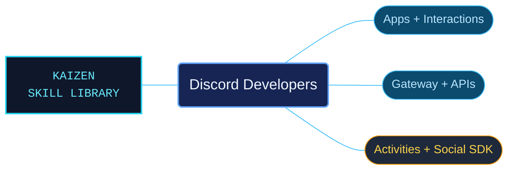

# Discord Developers

Discord developer references for applications, bots, embedded Activities and game integrations. The package organizes API contracts and lifecycle guidance by feature, helping an agent connect requests, events, permissions and responses without treating every Discord interface as interchangeable.

Use when building Discord apps or bots: HTTP/REST endpoints and objects, Gateway events/intents/opcodes, commands, interactions, message/modal components, OAuth2, permissions, rate limits, webhooks, guilds, channels, users, messages, monetization, Activities/Embedded App SDK, Rich Presence or C++/Unity/Unreal Social SDK integration. Not for ordinary end-user Discord use or unrelated services.

## What this skill helps with

| Task | Useful reference material |
| --- | --- |
| [Implement commands and interactions](references/interactions-index.md) | Find command definitions, interaction responses and related component workflows. |
| [Handle events and API transport](references/gateway-index.md) | Check Gateway delivery and follow the HTTP/authentication references for REST operations. |
| [Build embedded Activities](references/activities-index.md) | Locate Activity lifecycle and Embedded App SDK integration guidance. |
| [Integrate game and social features](references/native-sdk-index.md) | Select the native or engine SDK material relevant to the application. |

## The work behind the references

The documentation is interpreted into subject catalogs with explicit API fields, setup links and version conditions. Dated changes have their own chronological catalog, while current-task routes lead to the corresponding API or SDK subject.

## Start here

Start with [SKILL.md](SKILL.md) and follow its context routes.

Read the [API contract guidance](references/api/reading-contracts.md) when checking authorization, delivery mode or version-specific behavior. Bundled snapshots and examples do not establish current service behavior or prove a native integration has been executed.

## Sources and license

Skill reference documentation is interpreted content for use in open source projects. Check against [official documentation sources](https://docs.discord.com/developers/intro) when dealing with defects or issues that may come up from interpreting this skill's references.

Licensed under **Apache-2.0**; see [LICENSE](LICENSE). Part of the [Agent Kaizen](https://github.com/LevyBytes/agent-kaizen) skill library.
